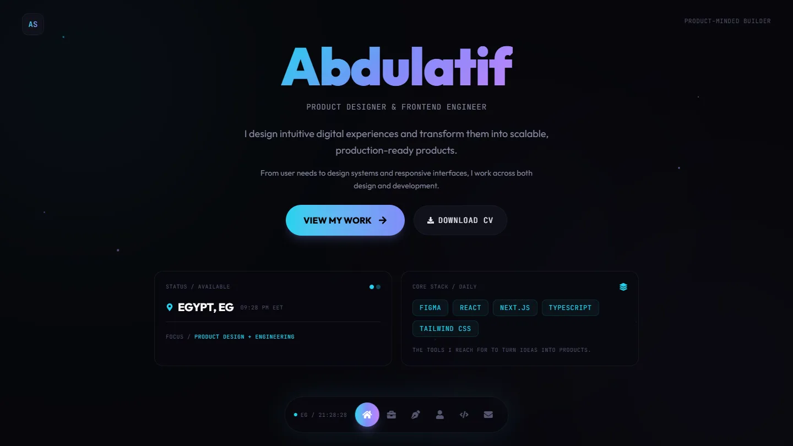
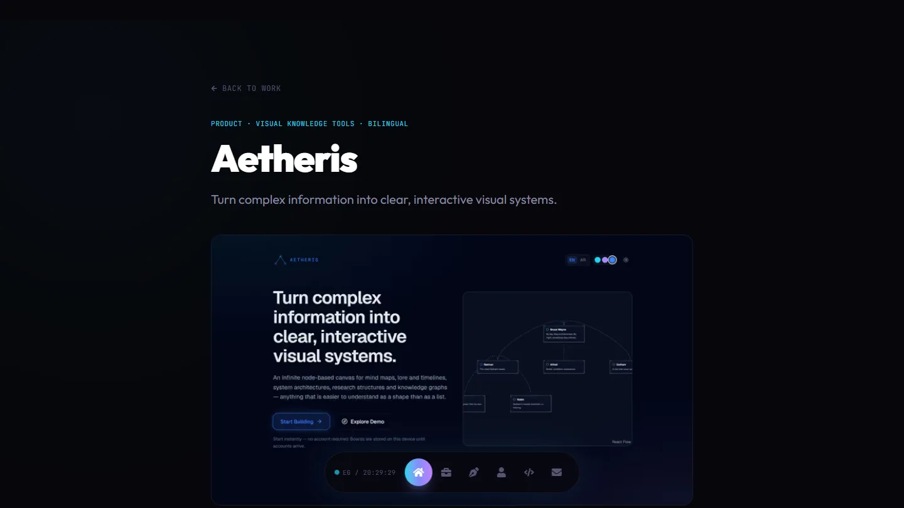
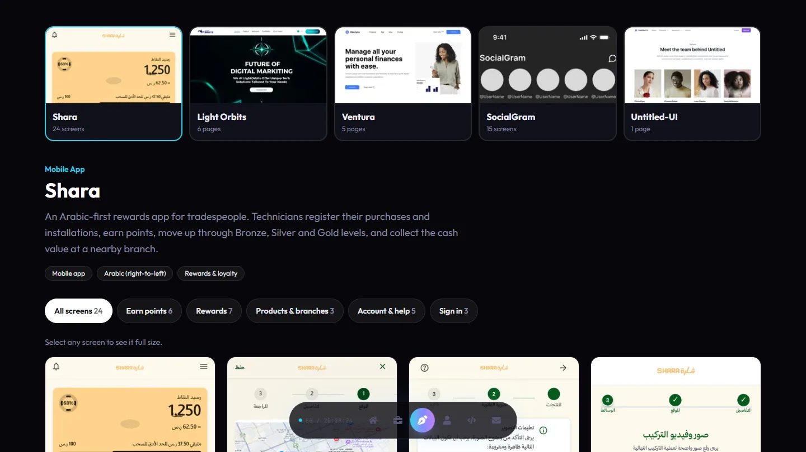

<div align="center">

# Abdulatif Selem

### Product Designer & Frontend Engineer

I design intuitive digital experiences and transform them into scalable, production-ready products.

**[View the live portfolio →](https://abdullatif-selem.vercel.app)**

[](https://nextjs.org)
[](https://react.dev)
[](https://tailwindcss.com)
[](https://motion.dev)
[](https://gsap.com)

<br />

<a href="https://abdullatif-selem.vercel.app">
  
</a>

</div>

## At a glance

| | |
|---|---|
| **18 web projects** | From products and tools to company and clinic websites |
| **6 in-depth case studies** | The problem, the decisions, and the result behind each product |
| **51 design screens and pages** | UI/UX work you can browse full size, with no account or design tools |
| **Motion that respects you** | Animated throughout, and calmer for visitors who prefer reduced motion |

## Featured work

| Project | What it does | Links |
|---|---|---|
| **Aetheris** | Turn complex information into clear, interactive visual systems. | [Live](https://aetheris-canvas.vercel.app/) · [Case study](https://abdullatif-selem.vercel.app/work/aetheris) |
| **Parallax** | The operating system for your agency. | [Live](https://parallax-agency.vercel.app) · [Case study](https://abdullatif-selem.vercel.app/work/parallax) |
| **Orenda** | A profile, not a label. | [Live](https://orenda-care.vercel.app) · [Case study](https://abdullatif-selem.vercel.app/work/orenda) |
| **Shot Craft** | Store-ready screenshots, processed entirely in your browser. | [Live](https://shot-craft-web.vercel.app) · [Case study](https://abdullatif-selem.vercel.app/work/shot-craft) |

<br />

<a href="https://abdullatif-selem.vercel.app/work/aetheris">
  
</a>

## UI/UX designs

Pick a project, select any screen, and see it full size. Zoom in on the details, and use the buttons, arrow keys, or a swipe on your phone to move between designs.

<a href="https://abdullatif-selem.vercel.app/ui-ux">
  
</a>

<br />

| Project | Type | Size | About |
|---|---|---|---|
| **Shara** | Mobile app | 24 screens | An Arabic-first rewards app for tradespeople |
| **Light Orbits** | Website | 6 pages | A space-themed site for a digital marketing agency |
| **Ventura** | Website | 5 pages | A clean, light site for a personal finance product |
| **SocialGram** | Mobile app | 15 screens | Greyscale wireframes of a social media app |
| **Untitled-UI** | Design system | 1 preview | A third-party kit I use and study, not my own design |

**[Browse all the designs →](https://abdullatif-selem.vercel.app/ui-ux)**

## Built with

| Area | Tools |
|---|---|
| **Framework** | Next.js 16 (App Router), React 19 |
| **Styling** | Tailwind CSS 4 |
| **Animation** | Framer Motion, GSAP |
| **Contact form** | EmailJS |
| **Icons** | React Icons |
| **Hosting** | Vercel |

## Run it locally

You'll need [Node.js](https://nodejs.org) 20.9 or newer.

```bash
git clone https://github.com/lancer7178/my-portfolio.git
cd my-portfolio
npm install
npm run dev
```

Then open [http://localhost:3000](http://localhost:3000).

| Command | What it does |
|---|---|
| `npm run dev` | Starts the development server |
| `npm run build` | Creates a production build |
| `npm start` | Runs the production build |
| `npm run lint` | Checks the code with ESLint |

## Project structure

```text
my-portfolio/
├── docs/                       Screenshots for this README
├── public/
│   ├── websites-cover/         Project cover images
│   ├── logo-company/           Company logos
│   ├── ui-ux design projects/  Design screens, one folder per project
│   └── design-previews/        Web-sized copies of very large designs
└── src/
    ├── app/                    Pages: home, /ui-ux, /ui-ux/[slug] and /work/[slug]
    ├── components/             Page sections and shared UI
    ├── data/                   All site content
    └── styles/                 Global styles and design tokens
```

## Updating the content

Text and project details live in `src/data/`, so most updates don't touch a component.

- **Add a web project:** put its cover in `public/websites-cover/`, then add an entry to `src/data/projects.js`. To give it a case study page, set `featured: true` and fill in the same case study details as the other featured projects.
- **Add a design:** put the screens in `public/ui-ux design projects/<project>/`, then add them to `src/data/figma.js` with their width, height, title and description.

> [!TIP]
> Vercel's image optimizer doesn't accept images taller or wider than 8192px. Resize very long page designs first, and keep the web-sized copy in `public/design-previews/`.

## Get in touch

<div align="center">

[](https://abdullatif-selem.vercel.app)
[](https://linkedin.com/in/abdul-atif-selem-8521a7281)
[](https://github.com/lancer7178)

Have a product to build or a role to fill? I'd love to hear about it.

</div>
